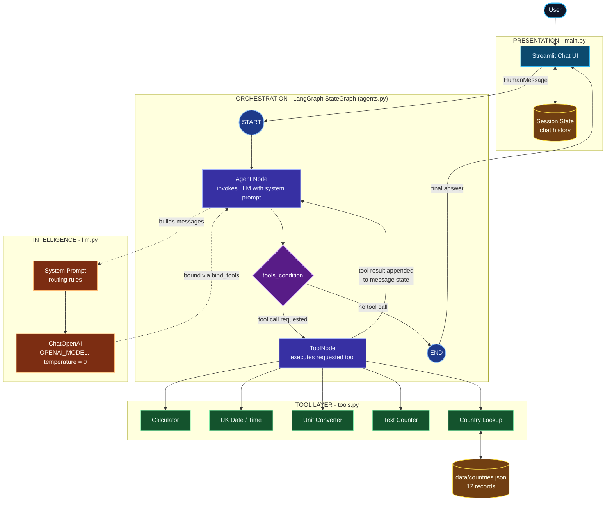
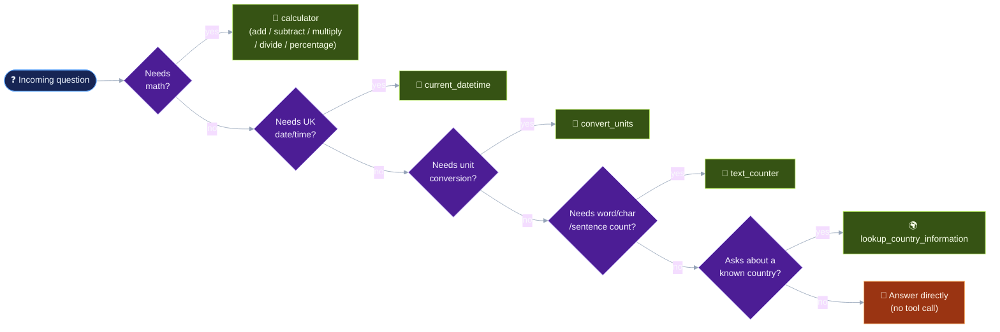
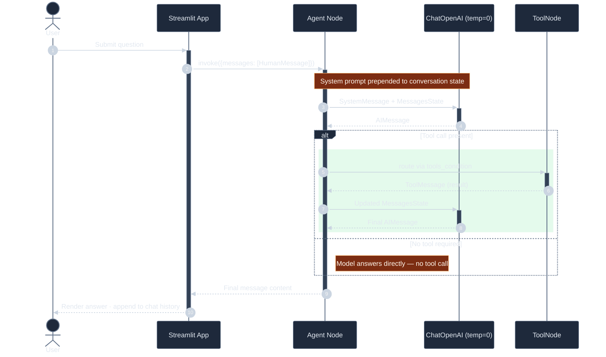
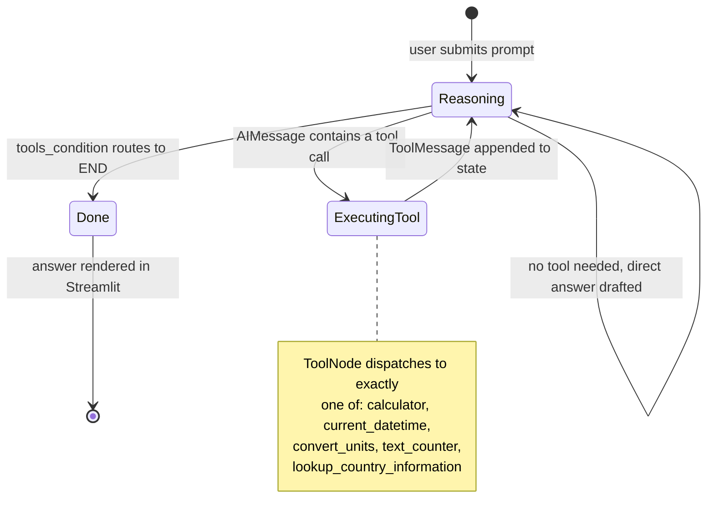

# 🤖 Smart Utility Tool Agent

A conversational utility assistant built with **Streamlit**, **LangChain**, **LangGraph**, and an OpenAI-compatible chat model. It decides whether a question can be answered directly or requires a specialised tool, executes that tool through a controlled LangGraph workflow, then returns a concise natural-language response.

The agent supports arithmetic, UK date/time, selected unit conversions, text statistics, and lookups from a bundled 12-country dataset.


---

## Table of contents

- [Highlights](#highlights)
- [Architecture](#architecture)
- [Tool-routing decision logic](#tool-routing-decision-logic)
- [Request lifecycle](#request-lifecycle)
- [Agent state machine](#agent-state-machine)
- [Project structure](#project-structure)
- [Available tools](#available-tools)
- [Prerequisites](#prerequisites)
- [Setup](#setup)
- [Run the web app](#run-the-web-app)
- [Try it](#try-it)
- [Terminal checks](#terminal-checks)
- [How routing works](#how-routing-works)
- [Configuration and observability](#configuration-and-observability)
- [Notebook](#notebook)
- [Dependencies](#dependencies)
- [Current scope and limitations](#current-scope-and-limitations)
- [License](#license)

---

## Highlights

- Tool-aware LLM with deterministic temperature (`0`) for reproducible routing decisions
- Conditional LangGraph routing between reasoning and tool execution via `tools_condition`
- Five focused, single-purpose LangChain tools bound to the model with `bind_tools`
- Streamlit chat interface with in-session conversation history and a clear-chat control
- Local JSON-backed country information (no external API dependency for lookups)
- Optional LangSmith tracing via environment variables for observability

---

## Architecture



**Shape language:** circle = graph `START`/`END` anchor, diamond = routing decision, cylinder = persisted state or data, plain rectangle = a processing node or tool. Every LLM response — the first pass or one after a tool result — is checked by the same `tools_condition` diamond: a tool call routes to `ToolNode`, which appends a `ToolMessage` and loops back into `agent` for another turn; only when a pass produces *no* tool call does `tools_condition` route to `END`, which is the only edge back out to the Streamlit UI.

---

## Tool-routing decision logic

The system prompt in [`agents.py`](agents.py) enforces deterministic rules rather than leaving tool choice purely to the model's judgement. This is what `tools_condition` and the prompt effectively implement:



Percentage questions receive extra prompt guidance: `18% of 74500` maps to `operation="percentage", a=18, b=74500`, and compound phrasing like "add 12% to 50000" instructs the model to compute the percentage first, then add it to the base value.

---

## Request lifecycle



The green band marks the sub-loop that only runs when the model requests a tool — `agent → tools → agent` — before the LangGraph run ever returns control to Streamlit. Activation bars show exactly which component is "on the stack" at each step.

---

## Agent state machine



---

## Project structure

```text
smart_utility_tool_agent/
├── agents.py              # System prompt, agent node, and compiled LangGraph workflow
├── tools.py               # Five LangChain tool implementations
├── llm.py                 # Environment-driven ChatOpenAI configuration
├── main.py                # Streamlit chat interface
├── test_agent.py          # Manual terminal query harness
├── new.ipynb              # Tutorial / exploratory walkthrough of the agent
├── requirements.txt       # Python dependencies
├── .env.example           # Safe environment-variable template
└── data/
    └── countries.json     # Bundled country lookup dataset (12 records)
```

`__pycache__/`, `.venv/`, and `.env` are local/generated and are excluded from version control via [`.gitignore`](.gitignore).

---

## Available tools

| Tool | Purpose | Supported operations / data |
| --- | --- | --- |
| `calculator` | Performs basic arithmetic | `add`, `subtract`, `multiply`, `divide`, `percentage` |
| `current_datetime` | Returns UK date and time | `Europe/London` timezone; formatted as `DD Month YYYY, HH:MM:SS AM/PM` |
| `convert_units` | Converts common measurements | kilometers↔miles, meters↔feet, kilograms↔pounds, Celsius↔Fahrenheit |
| `text_counter` | Analyses supplied text | words, sentences, characters, characters without spaces |
| `lookup_country_information` | Finds a country in the local dataset | name, capital, currency, population (millions), continent |

The country dataset ([`data/countries.json`](data/countries.json)) currently contains 12 records: Australia, Brazil, Canada, China, France, Germany, India, Japan, Singapore, the United Arab Emirates, the United Kingdom, and the United States. Lookups are case-insensitive exact-name matches.

---

## Prerequisites

- Python 3.10+ (the project uses the standard-library `zoneinfo` module)
- An OpenAI API key
- An OpenAI-compatible model available to your key

---

## Setup

1. Clone or download the project and enter its directory.

2. Create and activate a virtual environment.

   **Windows PowerShell**

   ```powershell
   python -m venv .venv
   .\.venv\Scripts\Activate.ps1
   ```

   **macOS / Linux**

   ```bash
   python3 -m venv .venv
   source .venv/bin/activate
   ```

3. Install the dependencies.

   ```bash
   pip install -r requirements.txt
   ```

4. Copy `.env.example` to `.env` and fill in your credentials.

   **Windows PowerShell**

   ```powershell
   Copy-Item .env.example .env
   ```

   **macOS / Linux**

   ```bash
   cp .env.example .env
   ```

5. Configure the required values in `.env`:

   ```dotenv
   OPENAI_API_KEY=sk-your-openai-key-here
   OPENAI_MODEL=gpt-4o-mini
   ```

   The template also includes optional LangSmith tracing variables. Keep `.env` private; it is already ignored by Git.

---

## Run the web app

```bash
streamlit run main.py
```

Streamlit will print a local URL, normally `http://localhost:8501`. The interface provides a sidebar with tool descriptions and example prompts, a clear-conversation button, and a chat input area.

---

## Try it

Examples of requests designed for the available tools:

```text
Calculate 18% VAT on £74,500
Convert 15 kilometers into miles
What is the current date and time in the UK?
Count the words in: LangGraph makes agent workflows explicit.
What are the capital and currency of Japan?
```

Questions that do not need one of the five tools are answered directly by the model.

---

## Terminal checks

`test_agent.py` is an executable manual test harness rather than a pytest suite. It submits representative prompts for every tool category plus a direct conversational prompt.

```bash
python test_agent.py
```

The script requires the same `.env` configuration and network access as the Streamlit app because it invokes the configured LLM.

For a local syntax-only validation that does not call the API:

```bash
python -m py_compile agents.py tools.py llm.py main.py test_agent.py
```

---

## How routing works

[`agents.py`](agents.py) binds all registered tools to the configured LLM with `llm.bind_tools(tools)`. For each request, the `agent` node prepends its system prompt and invokes the model. LangGraph's `tools_condition` inspects the resulting message:

- A normal answer ends the graph and is returned to the UI.
- A tool call is sent to `ToolNode`, which runs the matching Python function from [`tools.py`](tools.py).
- The tool result is appended to `MessagesState` as a `ToolMessage`, then control returns to the `agent` node so the LLM can phrase a clear final response.

This loop allows the model to choose a tool while keeping execution inside application-defined functions and data sources — the LLM never runs arbitrary code, only the five whitelisted tools.

---

## Configuration and observability

| Variable | Required | Description |
| --- | --- | --- |
| `OPENAI_API_KEY` | Yes | Credential used by `ChatOpenAI` |
| `OPENAI_MODEL` | Yes | Model identifier passed to `ChatOpenAI` |
| `LANGCHAIN_TRACING` | No | Enables LangSmith tracing when configured |
| `LANGCHAIN_API_KEY` | No | LangSmith API key |
| `LANGCHAIN_PROJECT` | No | LangSmith project name |
| `LANGCHAIN_ENDPOINT` | No | Optional LangSmith endpoint override |

---

## Notebook

[`new.ipynb`](new.ipynb) is a step-by-step learning notebook covering package installation, tool definitions, model binding, the graph, sample invocations, message inspection, and an earlier textual architecture sketch. The runnable application code lives in the Python modules described above.

---

## Dependencies

The project declares these direct dependencies in [`requirements.txt`](requirements.txt):

- `langchain`
- `langchain-core`
- `langchain-openai`
- `langgraph`
- `python-dotenv`
- `streamlit`

---

## Current scope and limitations

- Country information is limited to exact case-insensitive names in the bundled 12-record dataset.
- Unit conversion intentionally supports the specific pairs listed above; unsupported pairs return a clear message rather than an error.
- The UI sends one new `HumanMessage` per invocation. It preserves rendered chat history in Streamlit session state, while each agent invocation begins with the latest prompt (the LangGraph state is not carried across turns).
- External answers depend on the selected model, API credentials, and network availability.

---

## License

No license file is currently included in this repository. Add one before distributing or reusing the project under specific terms.
